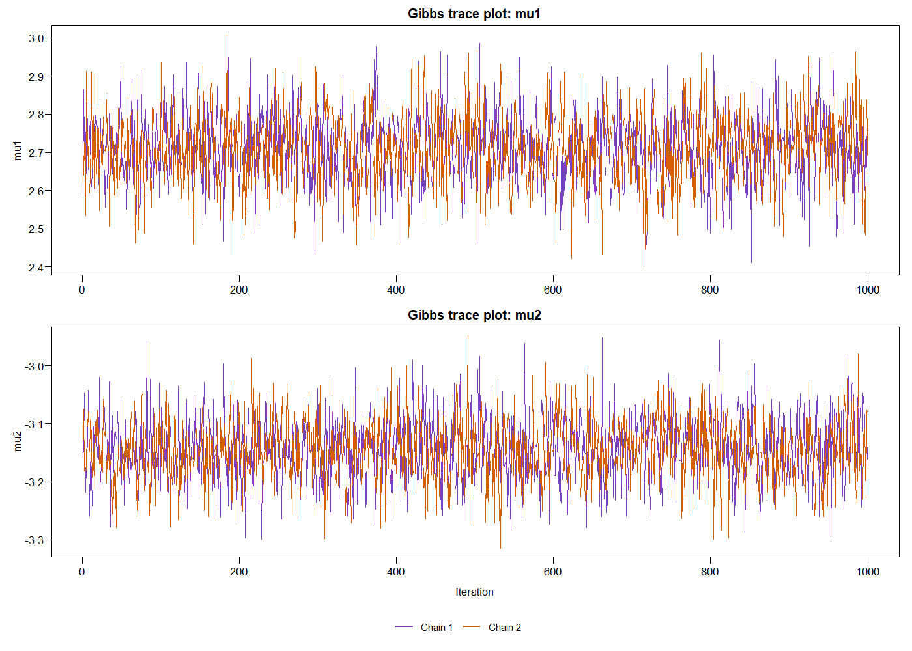
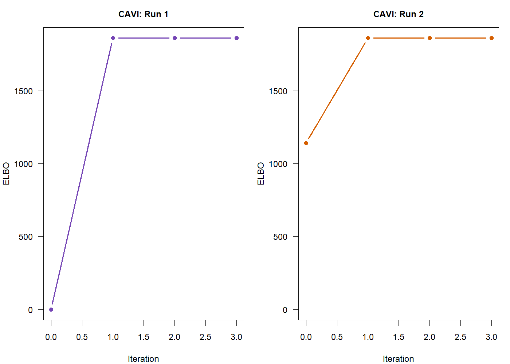

# Bayesian Inference: Gibbs, Metropolis-Hastings and Variational Inference

## 中文概览

### 贝叶斯推断与算法比较

使用 R 实现 Gibbs 采样、Metropolis–Hastings 采样和均值场变分推断，比较不同方法对后验分布的估计，并用解析解检验结果。

- **个人工作**：独立完成后验分布、全条件分布和 ELBO 的推导，编写采样器与 CAVI 算法，并分析初始化、收敛过程及 90% 可信区间。
- **主要结果**：两种采样方法的后验均值均接近解析解；两组初始化下，CAVI 均在 3 次更新后收敛，均值与解析结果一致。
- **验证与展示**：R 代码已重跑，仓库提供双链轨迹、后验密度、ELBO 曲线和数值检查结果。整理版新增了解析后验对照与自动检查。

项目使用模拟教学数据，以二维高斯模型展示算法原理与不确定性分析。完整推导、运行方式和验证细节见下方说明。

## English documentation

Implement and compare three Bayesian inference methods on a bivariate Gaussian posterior with a correlated prior. A separate conjugate Normal–Gamma example derives a posterior predictive Student-t distribution.

### Results reproduced in R

| Method | Mean mu1 | Mean mu2 | Setup |
| --- | ---: | ---: | --- |
| Exact posterior | 2.710268 | -3.145637 | Gaussian precision-matrix solution |
| Gibbs | 2.714452 | -3.144269 | 1,000 updates; discard first 100 |
| Random-walk MH | 2.707242 | -3.148585 | 4,000 updates; discard first 200 |
| Mean-field CAVI | 2.710268 | -3.145637 | Two starts; 3 updates each |

MH acceptance rates are 43.05% and 42.725% for the two starts. Posterior summaries use the first sampling chain after burn-in. See [numeric results](results/posterior-summary.csv), [variance comparison](results/variance-comparison.csv) and [validation record](results/validation.txt).





### Reproduce

From the repository root, run:

```sh
Rscript run_analysis.R
```

Only base R is required. The script recreates five diagnostic PNGs and numeric results. It was executed with R 4.5.2. To render the derivations separately, install Quarto and its R/knitr dependencies, then run `quarto render analysis.qmd`. Quarto rendering has not been tested in this environment.

### Interpretation

CAVI recovers the exact posterior means in this Gaussian example. Its independent factors omit the small posterior covariance and slightly understate marginal variances. The discrepancy is small here: this example does not demonstrate large variational approximation error. The ELBO is recorded up to a shared additive constant and is not a normalised log evidence.

Trace plots and numerical benchmark checks support this particular run. Full ESS/R-hat diagnostics and high-dimensional benchmarking are not included. A five-MCSE check is a reproducibility diagnostic, not proof of general convergence.

### Source and contribution

Individual MAST30027 Modern Applied Statistics coursework, University of Melbourne, 2026. Data are supplied simulated educational observations (100 scores, 100 group-x observations, 150 group-y observations). Original assignment instructions and identifying submission headers are omitted. No licence is assigned to the supplied data or course material.

See [review notes](docs/REVIEW.md) and [contributions](docs/CONTRIBUTIONS.md).
